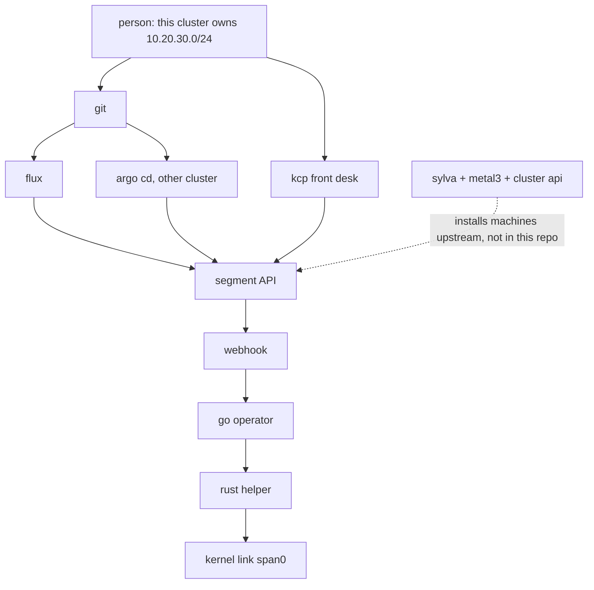

# span

Span keeps one promise: this cluster owns this block of addresses, and nobody else does.

Think of a street. Two teams both write "we live on 10.20.30.0/24" in a spreadsheet. Mail (packets) goes to the wrong house. The app looks broken, and people debug the app. Span is the one notebook that says who owns the street, and a worker that refuses a second claim.

The same notebook also catches a gateway typed outside the block, a typo that tries to claim the whole internet, and an address that was typed by hand and disappears when a machine is reinstalled. The person who chooses the prefix does not need root. Only a small helper is allowed to touch the network card.

## technologies

| piece | job |
| --- | --- |
| Go operator | reads a `Segment` and decides the plan |
| Kubernetes | stores the form. the CRD is `segments.span.dev` |
| Rust helper | talks to the kernel with netlink and reports what is really there |
| Flux | git is the notebook. Flux makes the cluster match it |
| Argo CD | a second installer, on a cluster Flux is not already managing |
| kcp | the front desk. many workspaces use one Segment API. it does not install machines |
| Sylva, Metal3, Cluster API | the public way to install Kubernetes on bare metal. not copied into this repo |

On this laptop the helper programs a dummy device named `span0` inside its own network namespace. That proves the kernel path. It is not a bare-metal cluster. Sylva needs hardware this Mac does not have.

## how the pieces connect



The webhook stops a bad form before it is stored. The operator still checks, because the webhook can be off. If two segments overlap, the older one keeps the prefix. The helper does not invent that rule. It only adds or removes what the operator asked, then lists what the kernel has.

More of the story is in [learning.md](learning.md). The wiring and the tradeoffs are in [architecture.md](architecture.md).

## tests

```sh
go test ./internal/planner
make test
make lint
```

## kind

This writes `bin/span.kubeconfig` and does not switch your current kubectl context.

```sh
make kind-demo
kubectl --kubeconfig bin/span.kubeconfig get segments
```

`segment/lab` should be Ready and Applied. `bad_segment.yaml` uses a gateway outside the prefix, and the webhook refuses it.

`make helper-self-test` builds the helper and runs its self-test in a privileged container. That is the kernel proof on this laptop. It is not a bare-metal cluster.

## git, then a second installer

```sh
sh hack/flux-lab.sh
sh hack/argo-lab.sh
```

Flux manages the kind cluster named `span`. Argo CD is installed on a different kind cluster, `span-argo`. The script checks that the flux cluster has no `argocd` namespace.

## kcp

kcp `v0.28.3` matches the SDK this repo builds against. Do not jump to a newer kcp without moving the Go version.

```sh
sh hack/kcp-lab.sh
```

The front-desk controller writes the plan. It does not program a network card. Overlap is checked inside one workspace.

`config/crd/conversion/segments.yaml` serves `v1` and stores `v1alpha1`. An object written as `v1alpha1` with no link still reads as `v1` with link `span0`. The kind demo keeps the single-version CRD so the controller tests do not need the conversion webhook.

## sylva

`hack/sylva-lab.sh` exits on purpose. Read [config/sylva/README.md](config/sylva/README.md). This Mac cannot boot that lab.

```sh
make kind-down
```
